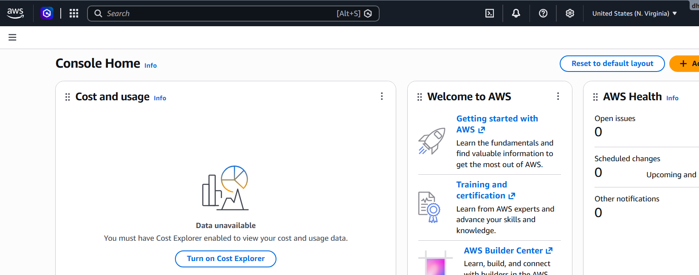
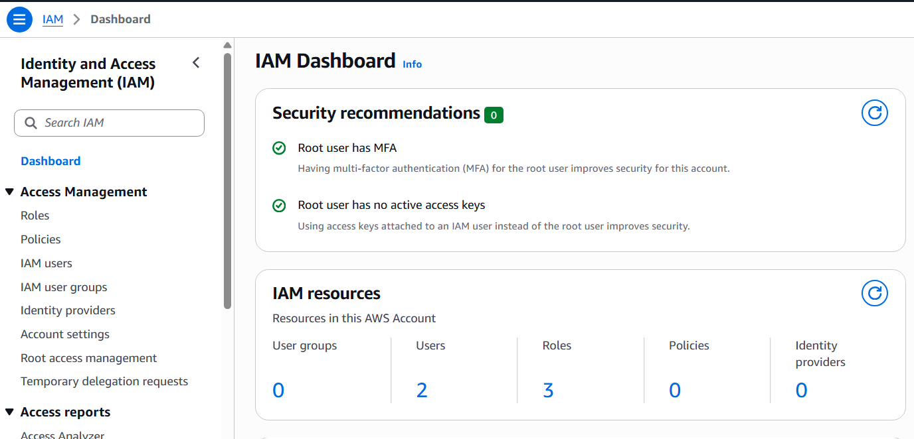
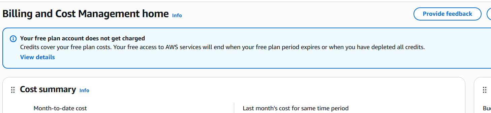

# DevOps Winter Arc: Day 22/90 - AWS Cloud First Look & Billing Safety

## 📌 Overview
Welcome to **Day 22** of the **#DevOpsWinterArc 90 Days Challenge**!  
Today marks our entry into Amazon Web Services (AWS). Rather than diving straight into deploying heavy cloud infrastructure, this module focuses on **orientation, account security, billing safety controls, and initial AWS Management Console exploration**.

---

## 🎯 Objectives
- Understand core AWS concepts and architecture terminology (AWS, Regions, AZs, IAM, EC2, S3, VPC, CloudWatch).
- Perform safe account setup or verification, ensuring strong authentication measures are active.
- Configure strict **Billing Safety Alerts** and **AWS Budgets** to enforce a $0 planned spend target.
- Conduct a safe AWS Console tour without provisioning or launching billable resources.

---

## 🧠 Part 1: AWS Core Concepts (In Simple Words)

- **AWS (Amazon Web Services):** A comprehensive cloud computing platform offering compute power, database storage, content delivery, and networking capabilities on-demand over the internet.
- **AWS Region:** A distinct geographic area worldwide (e.g., `us-east-1`, `eu-west-1`) containing multiple isolated cloud resources.
- **Availability Zone (AZ):** One or more discrete data centers within an AWS Region with redundant power, networking, and connectivity.
- **IAM (Identity and Access Management):** A service for securely managing access to AWS resources and controlling user authorization.
- **EC2 (Elastic Compute Cloud):** Resizable virtual servers in the cloud designed for compute tasks.
- **S3 (Simple Storage Service):** Highly scalable object storage designed for files, backups, and static assets.
- **VPC (Virtual Private Cloud):** A logically isolated virtual network dedicated to your AWS account.
- **CloudWatch:** A monitoring and management service providing metrics, logs, and billing alarms.

### Key Difference: EC2 vs. S3
- **EC2** is an **IaaS Compute** service providing virtual servers (CPU, RAM, OS) to run software applications.
- **S3** is an **Object Storage** service storing files and unstructured data natively accessible via HTTP APIs.

---

## 🔒 Part 2 & 3: Billing Safety & Security Checklist

Before viewing or managing any infrastructure in AWS, verify the following baseline safety settings:

- [x] **Root Account Protection:** MFA (Multi-Factor Authentication) enabled on the primary root account.
- [x] **Zero Access Keys:** Verified that no programmatic Access Keys are attached to the root account.
- [x] **AWS Budget Alert Configured:** Set up a monthly cost budget for **$0.00** (or smallest allowed threshold) with explicit email notification triggers.
- [x] **Billing Alarm Monitoring:** Enabled CloudWatch Billing Alerts in account preferences.
- [x] **Zero Active Compute:** Confirmed **0 Running EC2 Instances**, **0 Elastic IPs**, and **0 Load Balancers**.

> **Important Reminder:** A $0 budget alert serves as a notification mechanism; it **does not** act as a hard spend cap or auto-kill switch for running resources. Always manually terminate/clean up resources after practical labs!

---

## 🔍 Part 4: Console Exploration Matrix

| AWS Console Area | What Was Explored | Safety Rule Followed |
| :--- | :--- | :--- |
| **IAM** | Security status, MFA setup, root user credentials review | Did NOT create root access keys or overly permissive IAM accounts |
| **EC2 Dashboard** | Overview of compute resources, instance types, and pricing links | Did NOT launch any EC2 instances |
| **S3 Dashboard** | Storage bucket overview, access permission guidelines | Did NOT create S3 buckets or upload datasets |
| **VPC Dashboard** | Subnets, route tables, and security group configurations | Did NOT deploy NAT Gateways or Internet Gateways |
| **Billing & Cost Mgmt** | Usage graphs, AWS Budgets, Free Tier limits tracker | Reviewed billing details without initiating paid services |

---

## ❓ Part 5: Beginner Knowledge Check

1. **What is cloud computing?**  
   *Using computing resources (servers, storage, databases) on-demand over the internet rather than purchasing and managing physical hardware.*
2. **What is an AWS Region?**  
   *A separate geographic region hosting localized AWS infrastructure.*
3. **EC2 vs. S3?**  
   *EC2 delivers virtual compute engines; S3 provides scalable object file storage.*
4. **What does IAM do?**  
   *Controls who can authenticate (sign in) and who is authorized (has permissions) to use AWS resources.*
5. **Is every AWS service free under Free Tier?**  
   *No. Specific service-based quotas, execution time limits, and eligibility rules apply.*
6. **Does a $0 budget stop billing charges?**  
   *No. It triggers email alerts when spending thresholds are breached but does not stop active services.*
7. **Why enable MFA?**  
   *It adds a vital multi-step verification layer, drastically reducing account compromise risks.*
8. **What is mandatory after completing future practical labs?**  
   *Audit all deployed resources across active AWS regions, delete non-essential resources, and verify billing usage metrics.*

---

## 📸 Proof of Work Screenshots Checklist

- [x] **AWS Console Home Page** (Personal details/Account IDs obfuscated)
- [x] **AWS Budget Configuration** (Displaying $0 limit and active notification emails)
- [x] **Billing & Free Tier Dashboard** (Displaying $0.00 current spend)

### 1. AWS Console Home & Region Overview

### 2. AWS Budgets & Cost Alerts Setup

### 3. Billing & Free Tier Usage

---
*DevOps Winter Arc | Day 22 Complete*